# VibeFinder AI

VibeFinder AI is an intelligent music recommendation assistant for the CodePath AI110 Applied AI System project. Describe a listening situation in plain language and it ranks an 18-song fictional catalog, explains how the picks match, and identifies preferences the catalog cannot meet. The default workflow runs locally with zero API credentials.

## Original project

The [Module 3 Music Recommender Simulation](https://github.com/GabrielAnokye/ai110-module3show-musicrecommendersimulation-starter) ranked songs from a structured listener profile. It used a weighted content-based score, three ranking modes, optional advanced song attributes, diversity reranking, and terminal tables with scoring reasons. Its original CLI and catalog are still in use. [Module 3 README archive](docs/archive/module3/README.md) · [Module 3 model card archive](docs/archive/module3/model_card.md)

## What changed

- **Natural-language input and provenance.** The assistant interprets requests such as “music for studying” and marks preferences as explicit, inferred, or unknown.
- **Multi-source retrieval and planning.** A local index searches two original guides and catalog facts. Retrieved hints make context-only requests answerable and help explain catalog limits.
- **Grounded explanations and reliability.** The engine ranks and scores the songs. The template or optional Gemini and OpenRouter providers explain the verified results. Validation, one bounded correction, and deterministic fallback keep the response grounded and usable.
- **Observable workflow.** A JSON trace records stages, validation, decisions, and provider outcomes. Saved examples distinguish offline templates, simulations, live Gemini, and provider fallback. [Evidence index](evaluation/README.md#traces)

## Architecture



The assistant validates the request, interprets intent, retrieves evidence, and builds a plan. It filters and ranks the catalog, checks coverage, then validates the engine results before generating an explanation. Early branches return an error, clarification, or no-match result. Violet nodes represent external LLM providers. [Renderable Mermaid diagram](docs/architecture.md) · [Mermaid source](diagrams/architecture.mmd)

## Getting started

Verified in fresh macOS environments with Python 3.12 and 3.14. Application code uses the standard library. The requirements file installs `pytest` for verification.

```bash
git clone https://github.com/GabrielAnokye/vibefinder-ai.git
cd vibefinder-ai
python3 -m venv .venv
source .venv/bin/activate
python -m pip install -r requirements.txt
python -m src.main --ask "Music for studying."
```

Use a verified interpreter for `python3`. Run the original structured-profile CLI with `python -m src.main`. Use `--show-plan` with `--ask` to see more detail about the assistant's decisions.

## Example usage

### Studying

Context-only input leads to guide-derived targets. Captured offline output through the first ranked item follows.

```text
$ python -m src.main --ask "Music for studying."
VibeFinder AI assistant
Request: "Music for studying."

Interpreted request:
  Listening context: studying ("studying")
  Energy: 0.35 (inferred from listening_contexts#studying)
  Instrumentalness: 0.80 (inferred from listening_contexts#studying)
  Vocal intensity: 0.15 (inferred from listening_contexts#studying)
  Mood tags: focused (inferred from listening_contexts#studying)
  Songs requested: 5 (default)
  Not specified (no points either way): genre, mood, acoustic sound, popularity, release decade
Retrieved sources: listening_contexts#studying (0.36), music_features#vocal-intensity (0.17), music_features#instrumentalness (0.16)
Strategy: baseline ranking (default genre-first ranking); advanced features on; diversity reranking off

Recommendations (5 of 5 requested). Scores are out of 5 points available from your preferences (14 if every preference were set). [inferred] marks a target taken from a knowledge guide, not from you.

1. Focus Flow by LoRoom  [lofi, focused]
   Relevance: 4.74 / 5 (95%, strong match)
   Scoring (engine): Energy 0.40 vs target 0.35 (+2.85) [inferred]; Instrumentalness 0.90 vs target 0.80 (+0.45) [inferred]; Vocal intensity 0.03 vs target 0.15 (+0.44) [inferred]; Mood tags 1/1 matched: focused (+1.00) [inferred]
```

### Energetic workout with preferred genres

The assistant treats rock or hip-hop as a preference and infers an energetic, non-acoustic style from the workout guide. Captured offline output through the first two ranked items follows.

```text
$ python -m src.main --ask "I need energetic music for a workout, preferably rock or hip-hop."
VibeFinder AI assistant
Request: "I need energetic music for a workout, preferably rock or hip-hop."

Interpreted request:
  Listening context: workout ("workout")
  Genre: rock or hip-hop (you said "rock", "hip-hop")
  Energy: 0.85 (you said "energetic")
  Acoustic sound: no (inferred from listening_contexts#workout)
  Mood tags: energetic (inferred from listening_contexts#workout)
  Songs requested: 5 (default)
  Not specified (no points either way): mood, popularity, release decade, instrumentalness, vocal intensity
Retrieved sources: catalog#genre-hip-hop (0.43), catalog#genre-coverage (0.26), catalog#song-12 (0.22), music_features#genre-vs-mood (0.22), listening_contexts#workout (0.17), music_features#instrumentalness (0.10)
Strategy: energy-focused ranking (suggested by listening_contexts#workout); advanced features on; diversity reranking off

Recommendations (5 of 5 requested). Scores are out of 10 points available from your preferences (15 if every preference were set). [inferred] marks a target taken from a knowledge guide, not from you.

1. Breakwater by Redline Arcade  [rock, intense]
   Relevance: 9.81 / 10 (98%, strong match)
   Scoring (engine): Genre match: rock (+2.00); Energy 0.87 vs target 0.85 (+5.88); Acousticness 0.07, you prefer less acoustic (+0.93) [inferred]; Mood tags 1/1 matched: energetic (+1.00) [inferred]

2. Concrete Crown by Verse Theory  [hip-hop, confident]
   Relevance: 9.61 / 10 (96%, strong match)
   Scoring (engine): Genre match: hip-hop (+2.00); Energy 0.80 vs target 0.85 (+5.70); Acousticness 0.09, you prefer less acoustic (+0.91) [inferred]; Mood tags 1/1 matched: energetic (+1.00) [inferred]
```

### Guardrail for an unavailable required genre

“Only” makes metal a hard requirement. The assistant returns a no-match result. This is the complete offline output.

```text
$ python -m src.main --ask "Only recommend metal songs."
VibeFinder AI assistant
Request: "Only recommend metal songs."

Interpreted request:
  Genre requirement: only the named genre(s)
  Not in catalog: metal
  Songs requested: 5 (default)
  Not specified (no points either way): genre, mood, energy, acoustic sound, popularity, release decade, instrumentalness, vocal intensity, mood tags
Retrieved sources: music_features#genres-not-in-catalog (0.18), catalog#genre-coverage (0.17)

No match:
  The catalog has no metal songs [catalog#genre-coverage]. You asked for only metal, so I did not substitute other genres.
```

### Saved live Gemini explanation

These are the verbatim summary and Focus Flow explanation from the saved live study smoke. The item cited `listening_contexts#studying`. [Live smoke JSON](evaluation/results/live_gemini_smoke.json) · [Live smoke trace](evaluation/traces/live_gemini_smoke.json)

```text
Here are music recommendations tailored for your studying session, based on suggested targets for energy, instrumentalness, and vocal intensity.

This track features low energy (0.4) and low vocal intensity (0.03) with high instrumentalness (0.9), and matches the focused mood tag suggested by the studying guide.
```

Full offline outputs are available in the demo record. [Captured demos](evaluation/results/demo_outputs.md)

## Optional live AI configuration

Create a local, Git-ignored `.env` from `.env.example` if needed. For Gemini, set `GEMINI_API_KEY` and `GEMINI_MODEL`. The measured runs used `gemini-3.5-flash-lite`. For OpenRouter, set `OPENROUTER_API_KEY` and `OPENROUTER_MODEL`. Keep keys in your local environment and exclude them from logs and commits.

```bash
set -a
source .env
set +a
python -m src.main --ask "Music for studying." --provider gemini
# Select OpenRouter instead with --provider openrouter.
```

Live generation depends on credentials, account access, quota, and provider availability. The CLI identifies the provider that produced the final explanation. On macOS, a Python certificate error often points to the interpreter's trust store. The recorded Python installation had no default CA bundle. The shared transport now uses the macOS system bundle when Python has no default CA source or explicit override, with certificate and hostname verification enabled. For a Python.org installation, use its certificate installer or load a verified CA bundle through `SSL_CERT_FILE`. [Live experiment commands](evaluation/README.md#setup-and-request-budget) · [HTTPS troubleshooting](evaluation/README.md#https-troubleshooting)

## Design decisions

| Decision | Why |
|---|---|
| Engine-owned facts and ranking | The original score and catalog can be reproduced and validated independently of explanation wording. |
| `NO_PREFERENCE` for unknown fields | Missing preferences contribute zero points. A score uses only active preferences. |
| Local TF-IDF index | The two guides and catalog-derived facts fit a small local index. Source IDs make the retrieved evidence inspectable. |
| Explicit preferences take precedence | Guide hints fill eligible gaps. Listeners can override a general context assumption by stating what they want. |
| Hard constraints and diversity | Required genres, excluded artists, and artist uniqueness are enforced. Diversity reranking uses a soft repetition penalty. |
| Bounded correction and fallback | An invalid explanation can trigger one correction within a maximum of three HTTP attempts. The template can still explain ranked results when a provider or its output fails. |

## Evaluation and reliability

```bash
python -m pytest -q
python -m pytest -q tests/test_golden.py
python -m evaluation.run_evaluation
python -m src.main --ask "Music for studying." --trace-file /tmp/vibefinder-study.json
python -m evaluation.retrieval_comparison
```

| Evidence | Result |
|---|---|
| Automated tests | **417 passed**, including all **186** original tests. The **seven** original outputs matched byte for byte. |
| Offline harness | **22/22 cases** and **197/197 checks** passed against project-authored expectations. |
| Offline retrieval | Retrieval enabled answers for three context-only requests. The 62-passage multi-source index also enabled a labeled substitute for a soft metal request that the contexts guide alone could not answer. |
| Live Gemini | **13** HTTP attempts for **13** logical requests. **12/13** first answers passed validation. The smoke and both prompt arms returned live Gemini explanations. |
| Live retrieval comparison | **3/3** accepted with passages and **2/3** with passages withheld. The rejected answer cited a guide ID available in provenance and absent from the permitted sources. Rankings were held fixed. |
| Prompt specialization | Both arms passed **3/3**. Guide or inference wording appeared in **10/10 vs. 0/10** applicable items, and strict item-level preference-miss disclosure was **7/7 vs. 0/7** in the qualitative review. Specialized text averaged **23.6 vs. 16.5** words per item and used **20 vs. 29** structured citations. |

The live comparisons used one model and three synthetic requests, with one answer per arm per request. The evaluation measures behavior against the catalog and expected constraints. Listener satisfaction remains unmeasured. [Live report with raw evidence](evaluation/results/live_evaluation_report.md) · [Offline retrieval results](evaluation/results/retrieval_comparison.md) · [Evaluation index](evaluation/README.md)

## Limitations and responsible AI

The fictional catalog has uneven coverage. Scores reflect hand-selected weights and recorded preferences, while the rule-based interpreter can miss unfamiliar phrasing. Retrieved hints represent listening assumptions. Source-ID and numeric checks catch some generation errors, and qualitative review found wording that blurred catalog values with guide targets. The [model card](model_card.md) documents appropriate use, bias, privacy, and the HTTPS failure and recovery.

## Project structure

```text
.
├── src/
│   ├── main.py             Original and natural-language CLI
│   ├── recommender.py      Weighted scoring and diversity reranking
│   └── assistant/          Interpretation, retrieval, planning, validation and providers
├── data/
│   ├── songs.csv           Original fictional catalog
│   └── knowledge/          Listening-context and music-features guides
├── evaluation/             Harness, cases, results/ and traces/
├── tests/                  Automated tests and golden outputs
├── diagrams/architecture.mmd
├── assets/architecture.svg
├── docs/                   Architecture, portfolio, presentation, checklist and archive
├── model_card.md           Model evaluation, responsible AI and reflection
└── ai_interactions.md      Development decisions and AI interactions
```

## Reflection

The project evolved from scoring a structured profile to interpreting a listening request, retrieving evidence, and validating explanations. Mocked transports tested recovery behavior. Real HTTPS testing exposed a missing CA bundle and motivated a verified trust-store fallback and actionable diagnostics. The live outputs also showed that correctly formatted citations and accurate numbers can still leave the meaning of a claim unclear. [AI collaboration log](ai_interactions.md) · [Final rubric audit](docs/submission_checklist.md)
