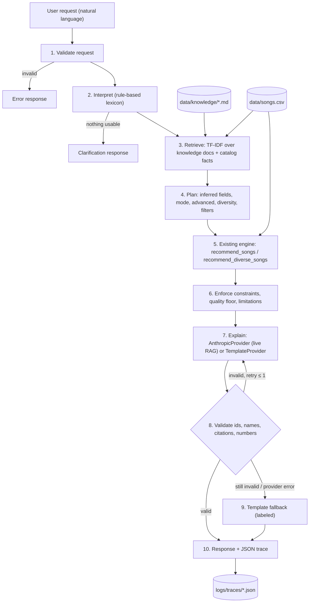

# VibeFinder AI — Applied AI System Design (Phase 1)

> **Status: proposed design.** Nothing in this document is implemented yet. The architecture
> diagram below is preliminary; the final `diagrams/architecture.mmd` and the image in `assets/`
> will be produced after implementation so they match the real system.

---

## 1. Original project's capabilities (verified 2026-11-23)

Everything below was checked against the repository at commit `aa45400`, not against earlier
descriptions.

| Capability | Where | Verified by |
|---|---|---|
| 18-song synthetic catalog, 10 original + 5 advanced columns | `data/songs.csv` | read; 13 genres, 9 moods, 16 artists (Neon Echo and LoRoom have 2 songs each) |
| Validated CSV loader (types, ranges, duplicate ids, all-or-none advanced columns, mood-tag vocabulary) | `load_songs` | read + tests |
| Weighted content-based score (genre 4, mood 3, energy ≤3, acoustic ≤1; max 11) | `score_song` | read + tests |
| Three ranking modes via a Strategy registry (`baseline`, `mood-first`, `energy-focused`) | `STRATEGIES`, `get_strategy` | read + CLI run |
| Optional advanced scoring (+≤3.0: popularity, decade, instrumentalness, vocal intensity, mood tags) | `advanced=True`, `_advanced_points` | read + CLI run |
| Greedy diversity reranking (−1.5 per earlier same-genre pick, −2.0 for a repeated artist) | `diversity_rerank`, `recommend_diverse_songs`, `DiversePick` | read + CLI run |
| Explanations: one reason string per score component, joined with `"; "` | `score_song` → `reasons` | read + tests (`test_explanations_add_up_to_the_score`) |
| ASCII tables (formatting only) | `src/table.py` | read + CLI run |
| CLI flags `--all-profiles --mode --diverse --table --advanced` | `src/main.py` | all ran, exit 0 |
| Weight-sensitivity experiment (patches module constants, restores them) | `experiments/weight_experiment.py` | ran, exit 0 |
| Automated tests | `tests/` | **186 passed** (advanced 56, recommender 53, modes 28, diversity 24, table 20, main 5) |

Baseline outputs of all seven commands are stored byte-for-byte in `tests/golden/` with a
`SHA256SUMS` file, so later phases can prove the original CLI did not change.

### Public interfaces

- **Functional:** `load_songs(path) -> list[dict]`, `score_song(prefs, song, mode, advanced) -> (float, list[str])`,
  `recommend_songs(prefs, songs, k, mode, advanced) -> list[(song, score, explanation)]`,
  `recommend_diverse_songs(...) -> list[DiversePick]`, `diversity_rerank(scored, k, ...)`,
  `max_possible_score(mode, advanced)`, `get_strategy(mode)`, `normalize_label(text)`.
- **OOP:** `Song`, `UserProfile` dataclasses; `Recommender(songs, mode, advanced).recommend(user, k)` and
  `.explain_recommendation(user, song)`.
- **Constants the assistant will read (never copy):** `STRATEGIES`, `MOOD_TAGS`, `REQUIRED_PREFERENCES`,
  `ADVANCED_PREFERENCE_FIELDS`, penalty and weight constants.

### Schemas

- `Song`: `id, title, artist, genre, mood, energy, tempo_bpm, valence, danceability, acousticness`
  + optional `popularity, release_decade, instrumentalness, vocal_intensity, mood_tags`.
- `UserProfile`: `favorite_genre: str, favorite_mood: str, target_energy: float [0,1], likes_acoustic: bool`
  + optional `target_popularity, preferred_decade, target_instrumentalness, target_vocal_intensity, preferred_tags`.

### How missing preferences are handled today

The engine is strict, by design and by test:

- All four basic fields are **required**. A missing key, an empty or whitespace string, a
  non-bool `likes_acoustic`, or an out-of-range energy raises `ValueError`
  (`test_invalid_profiles_are_rejected`).
- With `advanced=True`, **all five** advanced fields are required; `None` counts as missing
  (`test_missing_advanced_preferences_are_reported`).
- There is **no way to say "I don't care"** about a field. Every field either matches or costs points.

This is the main design problem for a natural-language front end: "calm instrumental music for
studying" names no genre and no acoustic preference, and almost no request names a decade or
popularity target. Filling those with defaults would invent preferences.

---

## 2. Problem being solved

Listeners describe situations ("studying for an exam", "a quiet evening"), not 0–1 energy
values, exact catalog labels, or Python dictionaries. VibeFinder AI lets them describe the
situation in ordinary language and:

1. interprets the request into explicit, inferred, and unknown preferences;
2. retrieves local guidance about listening contexts, features, and label relationships;
3. plans a call to the **existing** recommender (mode, advanced, diversity, filters);
4. explains the results using only engine facts and retrieved sources;
5. says plainly when the 18-song catalog cannot satisfy the request.

No song is ever presented unless it exists in `songs.csv`, and every score shown is the engine's.

---

## 3. Proposed AI assistant

**VibeFinder AI — Intelligent Music Recommendation Assistant**, invoked as:

```bash
python -m src.main --ask "I'm studying for an exam. Recommend calm instrumental music with some variety."
```

The output contains: the interpreted request (each field marked explicit / inferred / unknown,
with its source), any catalog limitations, the recommendations (engine scores, match-quality
label), a grounded explanation with source citations, and a line saying **how** the explanation
was produced (`claude-opus-5-5 (validated)`, `template (offline)`, or
`template (fallback after: <reason>)`).

---

## 4. Existing components to reuse (unchanged)

| Need | Reused component |
|---|---|
| Song identities and features | `load_songs` |
| Scoring and explanation reasons | `score_song` (via `recommend_songs`) |
| Ranking with deterministic ties | `recommend_songs` |
| Variety | `recommend_diverse_songs` / `DiversePick` |
| Mode selection | `get_strategy`, `STRATEGIES` |
| Valid label vocabulary | `MOOD_TAGS`, catalog genres/moods from `load_songs`, `normalize_label` |
| Score ceilings | `max_possible_score` |
| Table output | `recommendations_table`, `diverse_table` |

The assistant **never** re-implements the scoring formula. Filtering happens by passing a
smaller song list to the engine; merging multi-genre runs takes the engine's scores as-is.

### The one engine change: an explicit "no preference" value

**Recommended (Option A):** add a sentinel to `src/recommender.py`:

```python
class Preference(Enum):
    ANY = "any"
NO_PREFERENCE = Preference.ANY
```

Any preference field may be set to `NO_PREFERENCE`. That component then gives **0 points to
every song** (so it cannot affect the order) and its reason reads e.g.
`No genre preference given (+0.00)`. A helper `attainable_max_score(prefs, mode, advanced)`
reports the ceiling over the components the user actually specified.

Why this is safe:

- `None`, missing keys, empty strings, and wrong types are **still rejected** exactly as now,
  so all 186 tests and the golden outputs are unaffected. Only the new explicit value is accepted.
- An `Enum` member survives `dataclasses.asdict` (deep copy returns the same member), so the OOP
  path works too.
- Ranking with a field set to `NO_PREFERENCE` is identical to ranking with that weight set to 0 —
  this becomes a property test.

**Option B (zero engine change), not recommended:** use an unmatchable genre/mood string
(e.g. `"<none>"`). That is ranking-equivalent for genre and mood, but (a) the reason text
becomes `Genre pop is not <none>`, (b) it **cannot** work for `target_energy` or
`likes_acoustic` — any value biases the ranking — and (c) advanced scoring would need invented
popularity and decade targets, so it would almost never be usable from natural language.

If no core preference can be determined at all, the assistant asks for clarification instead
of ranking 18 songs by id.

---

## 5. New components and responsibilities

The proposal in the brief had six modules. That is reasonable; each is small. I recommend
keeping them but **not** adding further abstraction layers (no plugin registries, no class
hierarchies beyond the provider protocol).

```
src/assistant/
    __init__.py      run_assistant(request_text, options) -> AssistantResponse
    schema.py        dataclasses: Field(value, provenance, source), RequestPlan, AssistantResponse, TraceStep
    intent.py        rule-based interpreter: text -> RequestPlan (explicit / unknown fields, exclusions, k)
    retrieval.py     load knowledge docs, split by heading, TF-IDF ranking, catalog facts
    planner.py       fill inferred fields from retrieved hints, choose mode/advanced/diverse, filters, clarification
    provider.py      GenerationProvider protocol; AnthropicProvider, TemplateProvider, MockProvider
    validation.py    request, plan, recommendation, and explanation checks
    workflow.py      bounded 10-step pipeline, retries, fallbacks, trace writing
data/knowledge/      4 original markdown guides (see §7)
evaluation/          cases.json, run_evaluation.py
experiments/         retrieval_ablation.py, specialization_comparison.py (added later)
logs/traces/         committed JSON traces from evaluation runs
```

`schema.py` is split out only because four modules share the dataclasses; it holds no logic.

---

## 6. Natural-language request processing

### Structured plan

```text
RequestPlan
  raw_text, context ("studying" | "workout" | ... | unknown)
  genres:        Field[list[str]]   # catalog genres only
  unavailable_genres: list[str]     # named but not in catalog, e.g. "metal"
  mood:          Field[str]         # catalog mood
  mood_tags:     Field[list[str]]   # MOOD_TAGS only
  target_energy: Field[float]
  likes_acoustic: Field[bool]
  target_instrumentalness / target_vocal_intensity: Field[float]
  diversity:     Field[bool]
  no_repeat_artist: bool            # hard constraint
  exclusions:    {genres, moods, artists}
  k:             int (default 5, allowed 1–10)
  conflicts:     list[str]
```

Every `Field` carries `provenance ∈ {explicit, inferred, unknown}` and a `source`:
the matched phrase from the user (`explicit`), a retrieved source id (`inferred`), or none.
Only explicit and inferred values are passed to the engine; unknown ones become `NO_PREFERENCE`.

### Interpretation (default: rule-based, deterministic)

A lexicon-driven interpreter, not an ML model:

- **Genres:** catalog genre names plus an alias table loaded from the genre/mood guide
  (`hip hop`, `hiphop` → `hip-hop`; `rnb` → `r&b`). Recognized non-catalog genres (`metal`,
  `country`, `edm`…) go to `unavailable_genres`, never silently dropped.
- **Mood:** catalog moods plus synonyms from the guide (`calm` → `chill`, `sad` → `sad`,
  `nostalgic` → tag `nostalgic`).
- **Energy words:** `energetic, high energy, pump` → high; `calm, quiet, mellow, sleepy` → low.
  These are explicit when the user says them.
- **Flags:** `instrumental`, `no vocals`, `acoustic`, `variety / mix`, `don't repeat the same artist`.
- **Negation:** `no X`, `not X`, `without X`, `except X` → exclusions.
- **Count:** digits or number words (`three songs`).

### Missing, ambiguous, and contradictory requests

| Situation | Example | Behavior |
|---|---|---|
| Field not mentioned | no genre in the study request | `NO_PREFERENCE` (never invented) |
| Field implied by context | "studying" → low energy | `inferred`, only if a retrieved passage supports it, with its source id |
| Nothing usable | "recommend something" | **clarification** response listing what can be specified, with catalog options |
| Logical contradiction | "calm, high-energy music" | record in `conflicts`; explicit wins over inferred; if two explicit values contradict → clarification |
| Catalog-unsatisfiable combination | "sad, high energy" | proceed, add a **limitation** computed from catalog facts (sad songs have energy 0.14 and 0.27) |
| Unavailable genre | "metal" | limitation + substitutes inferred from the genre guide (`metal` → high energy, `aggressive`, low acoustic), labeled as substitutes, **not** as metal |

The planner uses deterministic logic for all of this; the LLM never decides what to send to the engine.

---

## 7. Retrieval design

### Knowledge sources (original, labeled educational documents)

All files start with a note: *"Authored for this project as design heuristics for an 18-song
synthetic catalog. Not scientific claims; not copied from any article."*

| File | Content | Example section id |
|---|---|---|
| `data/knowledge/listening_contexts.md` | study, workout, sleep, party, commute, quiet evening, focus, cooking… | `listening_contexts#studying` |
| `data/knowledge/feature_guide.md` | what energy, acousticness, instrumentalness, valence, vocal intensity mean **in this catalog** | `feature_guide#instrumentalness` |
| `data/knowledge/genre_mood_guide.md` | aliases, related genres for non-catalog genres, mood synonyms, mood ↔ tag links | `genre_mood_guide#metal` |
| `data/knowledge/strategy_guide.md` | when mood-first, energy-focused, diversity, and advanced scoring fit | `strategy_guide#variety-requests` |
| **catalog facts** (generated at runtime from `songs.csv`) | genre/mood counts, which combinations exist, energy ranges per mood | `catalog#mood:sad` |

Catalog facts are computed, not written, so they cannot drift from the CSV.

### Sections and stable ids

Documents are split on `##` headings. Each section's id is
`<file stem>#<slugified heading>`. Ids are stable as long as headings do not change; a test
asserts the full id list so an accidental rename fails loudly.

A section can carry one machine-readable line:

```text
hints: target_energy=0.35; target_instrumentalness=0.80; mood_tags=focused,reflective; diversity=true
```

The hint parser accepts **only** whitelisted keys with range-checked values (unknown keys,
out-of-range numbers, and unknown tags are dropped and logged). Prose is never executed or
followed as instructions.

### Relevance

Pure-Python TF-IDF with cosine similarity (≈60 lines, stdlib only — no scikit-learn):
lower-case, strip punctuation, drop a short stop-word list, light suffix stripping. The query
is the user's text plus the plan's explicit labels. Top 4 sections above a minimum similarity
(e.g. 0.10) are returned. Catalog facts are retrieved by exact key (genre/mood names in the
plan), not by similarity.

TF-IDF is a deliberate choice: with ~30 short sections, embeddings would add a heavy
dependency and non-determinism for no measurable gain, and TF-IDF scores are explainable in
the trace.

### How retrieval influences the result

1. **Plan:** hints from retrieved context sections fill *unknown* fields as *inferred* values
   with the section id as source (explicit user values always win).
2. **Limitations:** catalog facts decide whether a combination or genre is unavailable.
3. **Substitutes:** the genre guide supplies features for unavailable genres.
4. **Explanation:** retrieved passages are the only sources an explanation may cite; in live
   mode they are the context given to the model (genuine RAG).

**No relevant section found:** nothing is inferred, the trace records `retrieval: no match`,
and the response says the request was interpreted from the user's words only.

---

## 8. Agentic workflow

A bounded, code-orchestrated pipeline (the LLM does not choose the steps):

| # | Step | Tool / function | Decision made from intermediate results |
|---|---|---|---|
| 1 | Validate request | `validation.check_request` | empty / too long / k out of range → error response |
| 2 | Interpret | `intent.interpret` | nothing usable → clarification (stop) |
| 3 | Retrieve | `retrieval.search` + `catalog_facts` | no match → user words only |
| 4 | Plan | `planner.build_plan` | mode, advanced, diversity, filters; conflicts → clarification |
| 5 | Recommend | `recommend_songs` / `recommend_diverse_songs` on the filtered catalog | one run per requested genre, merged by engine score |
| 6 | Post-process | `planner.apply_constraints` | enforce no-repeat-artist and exclusions; drop matches below the quality floor; fewer than k → limitation |
| 7 | Explain | `provider.generate_explanation` | live model or template |
| 8 | Validate output | `validation.check_recommendations`, `check_explanation` | invalid → step 9 |
| 9 | Correct / fall back | one retry with the validator's error list, then template | max **1** retry per request |
| 10 | Return + trace | `workflow.write_trace` | JSON trace to `logs/traces/` when `--trace` is set |

Notes on specific behaviors:

- **Hard vs soft variety.** `diversity_rerank` only *penalizes* a repeated artist; it does not
  forbid one. "Don't recommend the same artist twice" is therefore enforced in step 6 by walking
  the full ranked list and skipping repeats. Scores are unchanged.
- **Quality floor.** A new, documented policy constant: results under 50 % of the attainable
  max are not shown as recommendations. This fixes the README's "always returns k songs" limitation.
- **Match-quality label** (`strong ≥ 75 %`, `partial ≥ 50 %`) is derived from engine score /
  attainable max. It is a heuristic confidence indicator, not a probability.

### Execution traces

Each trace is observable evidence only — no model reasoning is requested or stored:

```json
{"run_id": "eval-study-01", "request": "...", "steps": [
  {"step": 3, "action": "retrieve", "tool": "retrieval.search",
   "input": {"query": "studying exam calm instrumental variety"},
   "output": {"sources": ["listening_contexts#studying", "feature_guide#instrumentalness"]},
   "status": "ok"},
  {"step": 8, "action": "validate_explanation", "status": "failed",
   "output": {"errors": ["cites unknown source strategy_guide#sleep"]}},
  {"step": 9, "action": "fallback", "output": {"generator": "template"}, "status": "revised"}
], "final": {"song_ids": [9, 4, 6, 15, 7], "generator": "template (fallback)"}}
```

Committed traces use fixed run ids and omit wall-clock times so they are reproducible and diff cleanly.

---

## 9. LLM provider and offline fallback

```python
class GenerationProvider(Protocol):
    name: str
    def generate_json(self, system: str, user: str, schema: dict) -> dict: ...
```

| Provider | When | Label in output |
|---|---|---|
| `TemplateProvider` | default; no key; `--provider template` | `template (offline)` — **not** an LLM |
| `AnthropicProvider` | `VIBEFINDER_PROVIDER=anthropic` and credentials present | `<model id> (validated)` |
| `MockProvider` | tests only — scripted outputs: valid, malformed JSON, invented song, bad citation, timeout | `mock` |

**Anthropic provider details** (optional dependency `anthropic`, in `requirements-llm.txt`, not
in the core requirements):

- Model from `VIBEFINDER_MODEL`, default `claude-opus-5-5`. Credentials resolved by the SDK from
  `ANTHROPIC_API_KEY` (or an `ant auth login` profile). `.env.example` documents the variables;
  `.env` is git-ignored.
- JSON output enforced with `output_config={"format": {"type": "json_schema", "schema": ...}}`
  on `client.messages.create`, then parsed with `json.loads`. Schema-valid JSON is still checked
  by our validator, because a valid shape does not make the content true.
- `output_config.effort = "low"` (short, simple generation). Opus 5.5 thinking cannot be
  disabled; it is not requested for display and never logged.
- `timeout=30` s, `max_retries=1` on the client; plus the workflow's single validation retry.
  Worst case ≈ 2 billed calls per request.
- `stop_reason == "refusal"`, `max_tokens`, any `anthropic.APIError`, or timeout → template
  fallback with the reason recorded.

**What the model receives:** the request, the plan, the engine's results (id, title, artist,
genre, mood, features, score, reasons) and the retrieved passages, each wrapped in delimiters
and labeled as data. **What it returns:**

```json
{"summary": "...", "items": [{"song_id": 9, "explanation": "...", "citations": ["listening_contexts#studying"]}],
 "limitations": ["..."]}
```

Scores, titles, artists, and features in the final output are always rendered **from the
engine**, never copied from model text.

**Honesty about RAG.** Offline mode is *retrieval-grounded template explanation*, not LLM RAG.
Genuine RAG happens only with the live provider. To make it reproducible without a paid key,
one live evaluation run will be committed (`logs/traces/live/`, model id and date recorded),
and the README will say clearly which outputs came from a model.

---

## 10. Reliability guardrails

| Risk | Check | Deterministic? |
|---|---|---|
| Empty / whitespace request | reject with message | yes |
| Oversized request (> 500 chars) | reject | yes |
| k invalid or > 10 | clamp to policy range and note it, or reject non-numbers | yes |
| Unknown genre | `unavailable_genres` + limitation | yes |
| Contradictory preferences | `conflicts` → clarification or explicit-wins rule | yes |
| Missing fields | `NO_PREFERENCE`, never defaults | yes |
| Invalid generated JSON | parse + schema check → retry → template | yes |
| Nonexistent song id | ids must equal the engine's returned ids, same order | yes |
| Invented titles / artists | scan text for catalog titles/artists not in the result set; quoted titles not in catalog | partly — novel invented names in free prose can slip through |
| Unsupported citations | every citation ∈ retrieved ids for this request | yes |
| Incorrect scores | model text may not contain numbers that disagree with engine values; displayed scores come from the engine | yes for displayed values |
| Explicit exclusions | final list re-checked against exclusions | yes |
| Duplicate artist when prohibited | final list re-checked | yes |
| Prompt injection in user text | user text is data: only lexicon matches reach the plan; in live mode it is delimited and the model's output is still validated | structurally yes; model behavior no |
| Prompt injection in documents | docs are local and authored by us; hint parser whitelists keys; prose delimited as data | yes for hints |
| Provider error / timeout | caught, single retry, template fallback, labeled | yes |

**Needs human evaluation:** whether an explanation's *claims about music* are reasonable,
whether inferred context values (e.g. studying → energy 0.35) are sensible, tone, and whether
the recommendations would actually suit a listener. Schema and citation checks show an
explanation is *consistent with the engine and its sources*; they do not prove every sentence
is true.

---

## 11. Planned evaluation

1. **Unit tests** for each new module, plus engine tests for `NO_PREFERENCE`.
2. **Golden regression:** a test compares the seven original commands with `tests/golden/`.
3. **Evaluation harness** (`evaluation/run_evaluation.py`): runs the real `run_assistant` on
   ~12 predefined cases (the five example requests, empty request, k=50, injection attempt,
   contradictory request, exclusion request, unavailable genre, vague request). Each case lists
   expected status and checks such as `all_ids_in_catalog`, `genres_subset`, `excludes_genre`,
   `no_repeat_artist`, `has_limitation`, `citations_valid`, `scores_match_engine`,
   `count_at_most`. Prints case names, PASS/FAIL, failed checks with reasons, and the overall
   pass rate. Default runs offline; `--provider anthropic` runs live.
4. **Retrieval ablation** (stretch 1): same cases with retrieval on vs off. Metrics: fields
   filled with a cited source, mean |energy − context target| of the top songs, mean
   instrumentalness for instrumental requests, limitation detection for "metal", citations per
   explanation. Deterministic.
5. **Specialization comparison** (stretch 3): the explanation generator with a **general**
   prompt vs a **specialized** music prompt (catalog vocabulary, JSON schema, citation and
   limitation rules), same cases, live model. Metrics measured by our own validators: valid
   JSON rate, citation validity, unsupported song references, constraint/limitation mentions,
   explanation length. This is prompt specialization — **not fine-tuning**.

---

## 12. Rubric mapping

> I do not have the official rubric text. The mapping below is reconstructed from the project
> brief (four stretch features × 2 points = 8 bonus points) and the usual CodePath Applied AI
> final-project structure. **Please paste the official rubric so this can be checked line by line.**

| Likely criterion | How it is met |
|---|---|
| Builds on the earlier project; original project named and summarized | README "Original project" section; engine reused unchanged except `NO_PREFERENCE` |
| Substantial AI feature integrated into the system | NL interpretation → retrieval → planned engine call → grounded explanation |
| Feature actually changes behavior (not cosmetic) | retrieval fills plan fields and limitations; ablation shows the difference |
| Reproducible setup | `.venv`, `pip install -r requirements.txt`, offline default, `.env.example` |
| Guardrails / error handling / logging | §10 validators, fallbacks, JSON traces |
| Reliability / testing | unit tests, golden regression, evaluation harness, match-quality label |
| Architecture diagram in `assets/` | Mermaid source in `diagrams/`, rendered image in `assets/` |
| README: summary, architecture, setup, sample interactions, design decisions, testing summary, reflection | written after implementation from real outputs |
| Ethics / limitations / misuse | model card update: synthetic data, heuristic guides, LLM limits |
| AI collaboration reflection (helpful + flawed suggestion) | `ai_interactions.md` new section |
| Demo / walkthrough video | record after implementation |
| **Bonus: RAG enhancement** | multi-source retrieval (4 guides + catalog facts) + ablation |
| **Bonus: agentic workflow** | 10-step pipeline, tool calls, conditional retry/fallback, committed traces |
| **Bonus: specialization** | general vs specialized prompt comparison with measured metrics |
| **Bonus: test harness / evaluator** | `evaluation/run_evaluation.py` with pass/fail and pass rate |

---

## 13. Technical risks and open decisions

1. **Engine change approval.** Option A modifies `src/recommender.py` (additive). Needs your OK.
2. **Rubric uncertainty.** The mapping above is a reconstruction.
3. **Live LLM access.** Stretch 3 and genuine RAG need an API key and a small budget. Rough
   estimate: a few US cents per explanation call; ~25 calls for the comparison plus development
   runs — on the order of a few dollars at Opus 5.5 list prices. Without a key, stretch 3 cannot
   be honestly demonstrated.
4. **Rule-based interpretation is brittle** with unusual phrasing. Mitigation: the evaluation
   cases document what it handles; README states it plainly.
5. **Single-valued genre/mood in the engine.** Multi-genre requests need one engine run per
   genre (capped at 3) merged by score. Mood stays single-valued; extra moods go to `mood_tags`.
6. **Tiny catalog.** Many requests will legitimately end in limitations; that is a feature to
   show, not hide.
7. **Hand-written heuristics** in the knowledge docs (e.g. study → energy 0.35) are opinions;
   they must be labeled as such.
8. **Unused dependencies.** `requirements.txt` lists `pandas` and `streamlit`, which nothing
   imports. Recommend removing them (the `.venv` was created with `pytest` only).
9. **Stale documentation.** `model_card.md` §7 says "58 automated tests"; the suite has 186.
   Fix during the documentation phase.

---

## 14. Ordered implementation plan

| # | Task | Est. |
|---|---|---|
| 1 | Golden regression test over `tests/golden/` | 0.25 h |
| 2 | `NO_PREFERENCE` + `attainable_max_score` + tests | 0.5 h |
| 3 | Knowledge docs (4 files, labeled, with `hints:` lines) | 0.75 h |
| 4 | `retrieval.py` (sections, ids, TF-IDF, catalog facts) + tests | 0.5 h |
| 5 | `schema.py`, `intent.py` + tests | 1.0 h |
| 6 | `planner.py` (hints, mode/advanced/diverse, filters, constraints, floor) + tests | 0.75 h |
| 7 | `validation.py`, `TemplateProvider`, `workflow.py`, traces + tests | 1.0 h |
| 8 | `--ask`, `--provider`, `--no-retrieval`, `--trace` CLI flags | 0.25 h |
| 9 | Evaluation harness + cases + committed traces | 0.5 h |
| 10 | Retrieval ablation script | 0.25 h |
| 11 | `AnthropicProvider` + `MockProvider` tests | 0.75 h |
| 12 | Specialization comparison (live) | 0.5 h |
| 13 | README, model card, `ai_interactions.md`, final diagram + image | 1.5 h |
| | **Total** | **≈ 8.5 h** |

**Four-hour version** (if time is fixed): do 1, 2, 4–9 with **two** knowledge docs, keep the
evaluation harness, fold the ablation into the harness as a `--no-retrieval` flag (saves step
10), and do 11–12 only if a key is available. Documentation still has to happen — it carries
many rubric points — so cut code scope before docs.

---

## Preliminary architecture (PROPOSED — will be replaced after implementation)


