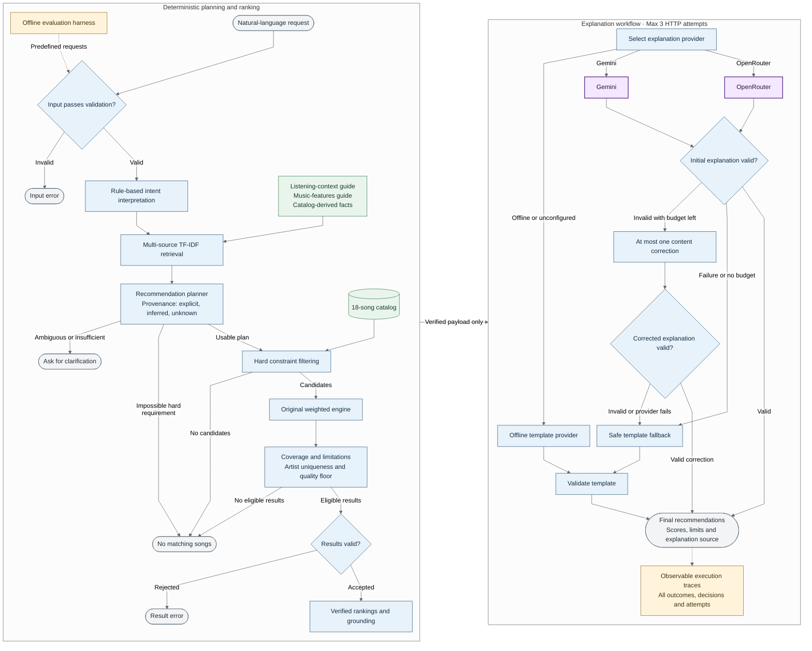

# VibeFinder AI architecture

Blue nodes run deterministic code. Violet nodes call an optional external LLM. Green nodes
provide local data and guides. The dashed edges connect the evaluation and tracing tools.

The planner labels explicitly stated preferences, eligible guide inferences, and unknowns.
The original engine owns the scores and rankings. The explanation workflow receives only
verified results plus the grounding used to explain them. The one content correction shares
a maximum of three HTTP attempts with the initial call and any transport retry. The offline
template can explain the same results if a live provider fails.

The evaluation harness drives the assistant with fixed requests. Traces record observable
stages, decisions, validation results, provider outcomes and attempt counts.

[Mermaid source](../diagrams/architecture.mmd) · [Rendered diagram](../assets/architecture.svg) · [Evaluation and traces](../evaluation/README.md)
